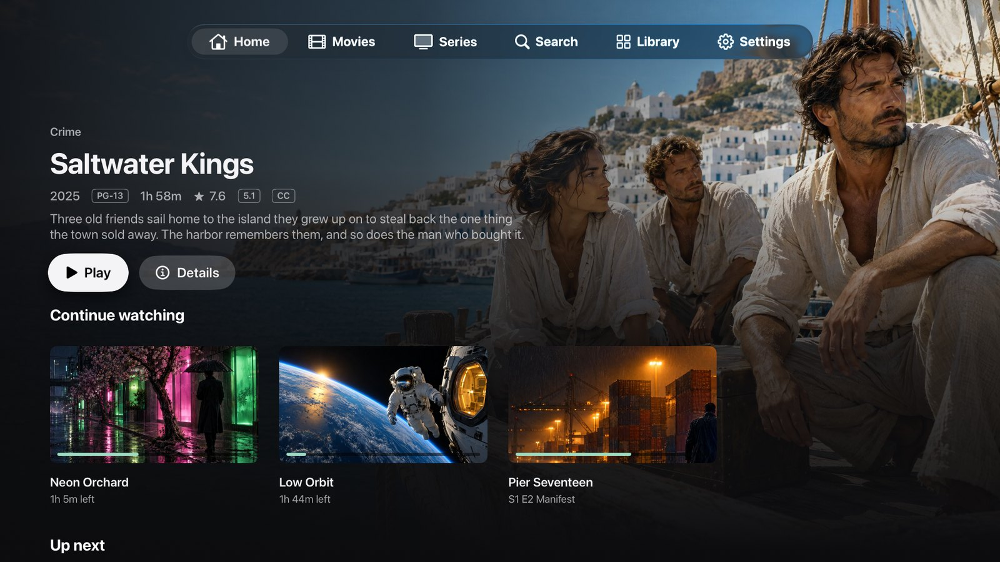
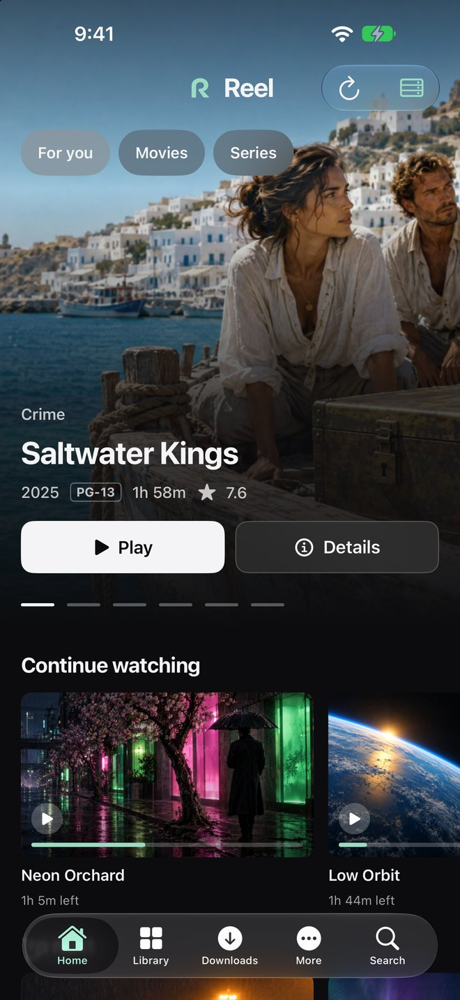
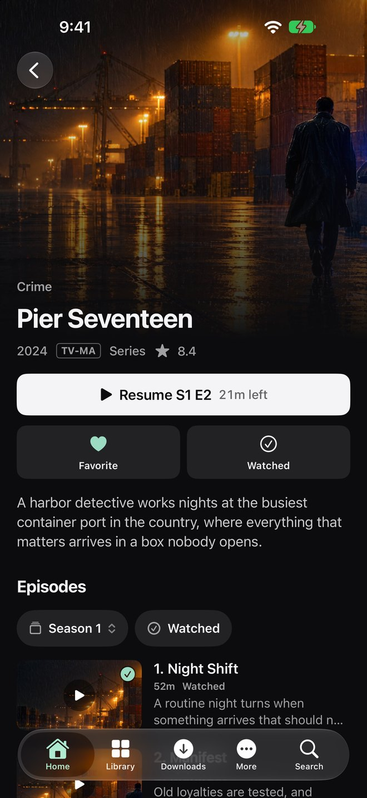
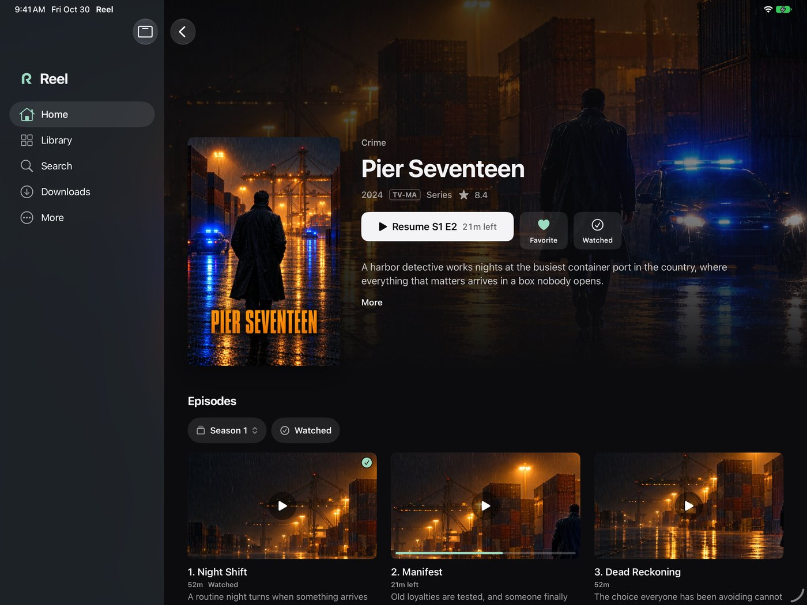
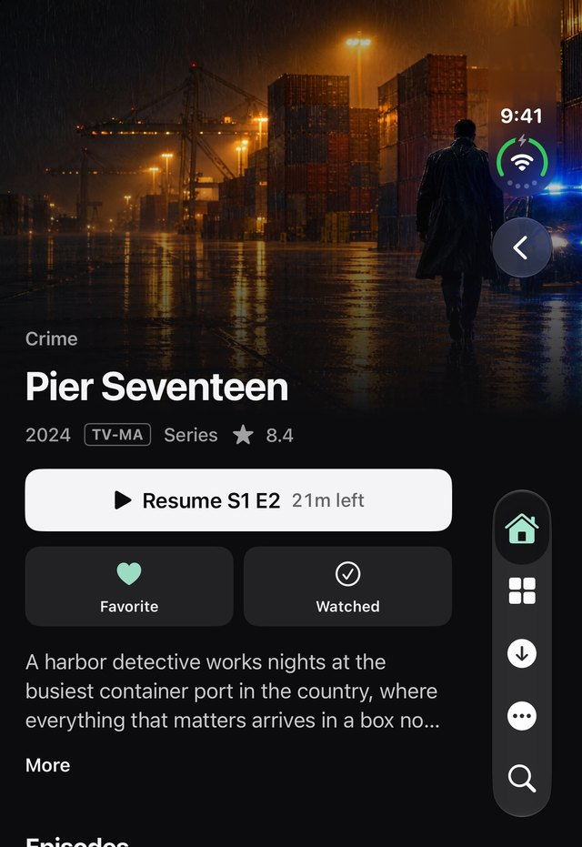
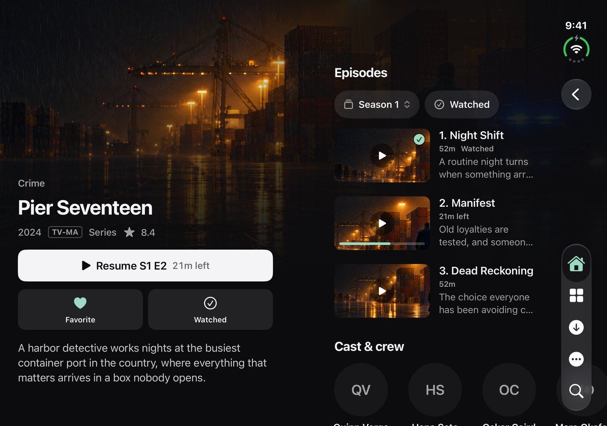
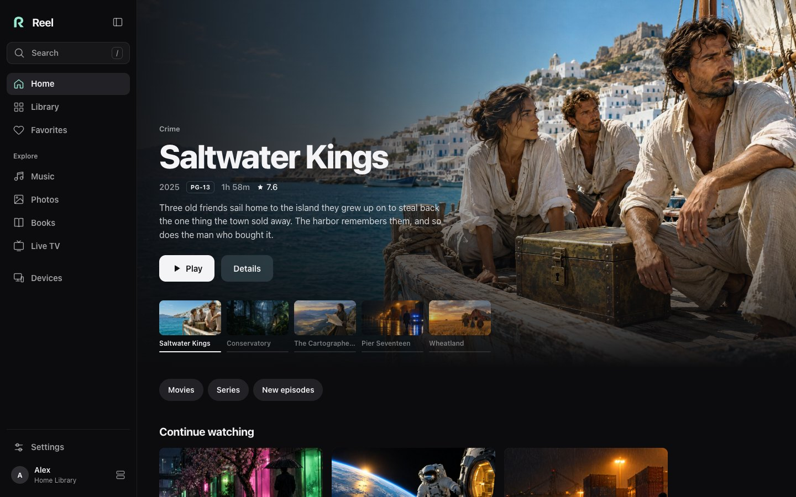
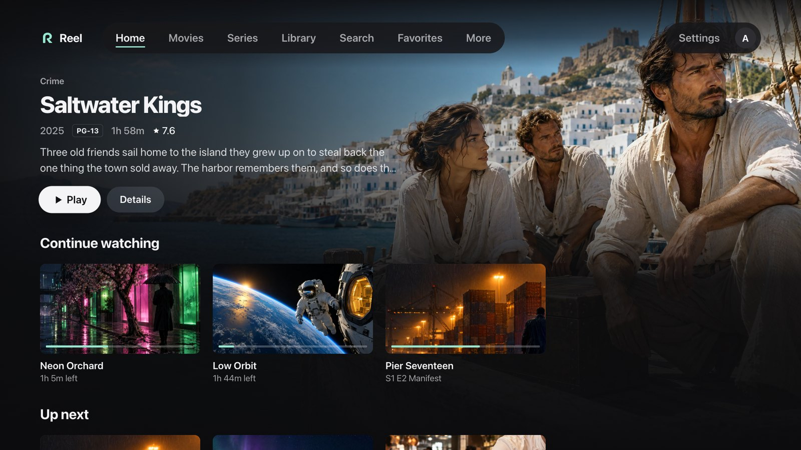

# Reel

A Jellyfin client for iPhone, iPad, Apple TV, the web, desktop and TV. It is open source under the MIT license.

## Screenshots

These use the demo library, with made-up titles and generated artwork. The [web app README](apps/web/README.md#run-locally) shows how to run it.

<p align="center">
  
  <br><sub>Apple TV</sub>
</p>

<p align="center">
  
  
  
  <br><sub>iPhone and iPad</sub>
</p>

<p align="center">
  
  
  <br><sub>iPhone Duo, folded and open</sub>
</p>

<p align="center">
  
  
  <br><sub>Desktop app and LG TV</sub>
</p>

## What Reel does

- Browse movies, shows and more with artwork-led screens, search, filters and favorites.
- Pick up where you left off, with Continue Watching, Next Up and recently added episodes.
- Play full-window video with quality, audio, subtitle and chapter controls.
- Fit the screen you are on: phones, tablets, both screens of iPhone Duo, desktop windows, and TVs you drive with a remote.
- Move between episodes with Previous, Next, a season browser and an optional automatic next episode. Skip Intro appears when your server provides the timestamps.
- Keep several servers and accounts, each with its own browsing preferences.
- Install the web app on a phone or computer, or host it yourself with Docker.
- Download videos for offline viewing on iPhone and iPad.

What you can do varies by client and by server. The [feature guide](docs/features.md) has the details.

## Clients

| Platform | Install |
|---|---|
| iPhone, iPhone Duo and iPad | [Build in Xcode](docs/install/apple.md#iphone-and-ipad) |
| Apple TV | [Build in Xcode](docs/install/apple.md#apple-tv) |
| Web and Docker | [Host the web app](docs/install/web-docker.md) |
| macOS, Windows and Linux | [Desktop packages (unsigned)](docs/install/desktop.md) |
| LG webOS | [Install the IPK (experimental)](docs/install/televisions.md#lg-webos) |
| Samsung Tizen | [Build and sign (experimental)](docs/install/televisions.md#samsung-tizen) |
| Roku | [Developer ZIP (experimental)](docs/install/televisions.md#roku) |

Reel is early software. The [installation guide](docs/install/README.md) lists what you need for each platform, and [platform support](docs/platforms.md) lists known limits. Android is not supported.

## Docker quick start

From the repository root:

```sh
docker compose -p reel -f docker/compose.yml up --build -d
```

Open [127.0.0.1:18790](http://127.0.0.1:18790) and connect to your Jellyfin server. See the [Docker guide](docker/README.md) for HTTPS, other devices and updates.

## Build from source

Each app has a README with its own steps:

- [Web and LG webOS](apps/web/README.md)
- [Desktop](apps/desktop/README.md)
- [iPhone and iPad](apps/apple/README.md)
- [Apple TV](apps/tvos/README.md)
- [Samsung Tizen](apps/tizen/README.md)
- [Roku](apps/roku/README.md)

Most of them need Node.js 22.12 or newer. The Apple apps need Xcode 27.1 and [XcodeGen](https://github.com/yonaskolb/XcodeGen). [AGENTS.md](AGENTS.md) lists the build and test commands side by side.

## Privacy

Reel connects only to the servers you choose. It has no accounts, no analytics and no built-in server address. Remembering a connection is optional, and passwords are never saved. [PRIVACY.md](PRIVACY.md) explains what each client stores. Report vulnerabilities privately as described in [SECURITY.md](SECURITY.md).

## Contributing

Read [CONTRIBUTING.md](CONTRIBUTING.md) first. Test against throwaway servers and the synthetic fixtures in the repository, never a library you care about.

## License and affiliation

Original code is released under the [MIT license](LICENSE). Dependencies and bundled third-party notices keep their own licenses, listed in [THIRD_PARTY.md](THIRD_PARTY.md). Jellyfin and Google Cast belong to their respective owners. Reel is an independent client and is not endorsed by them.
